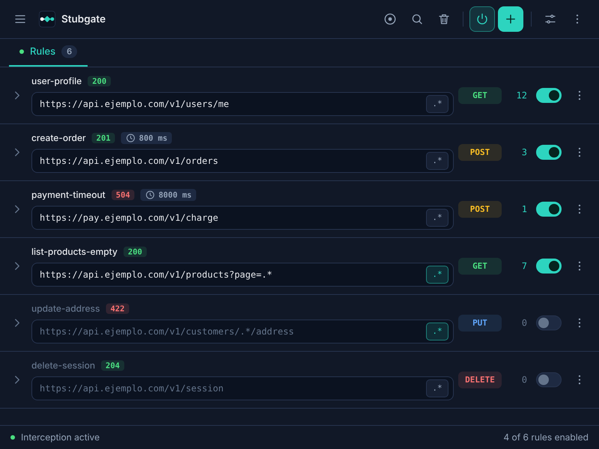
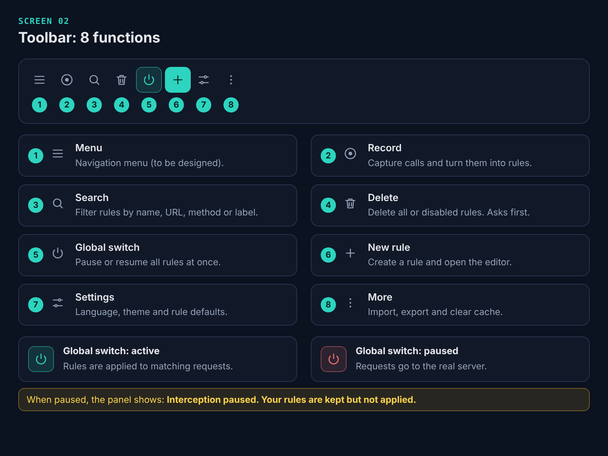
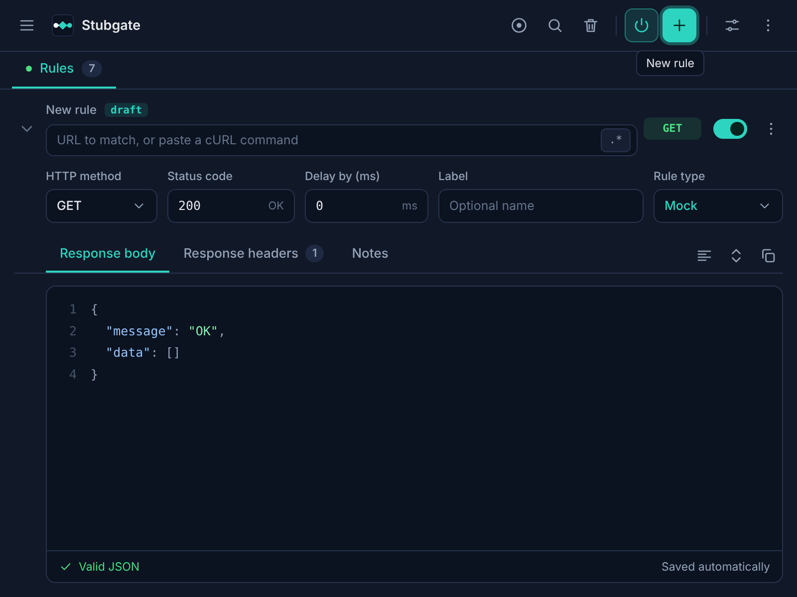
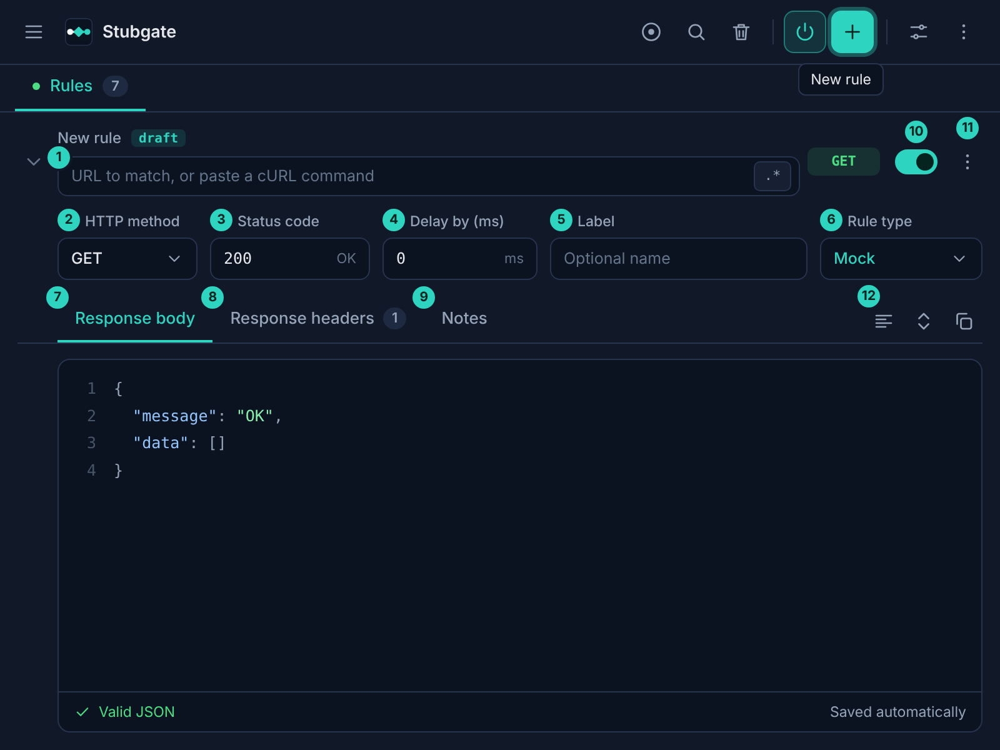
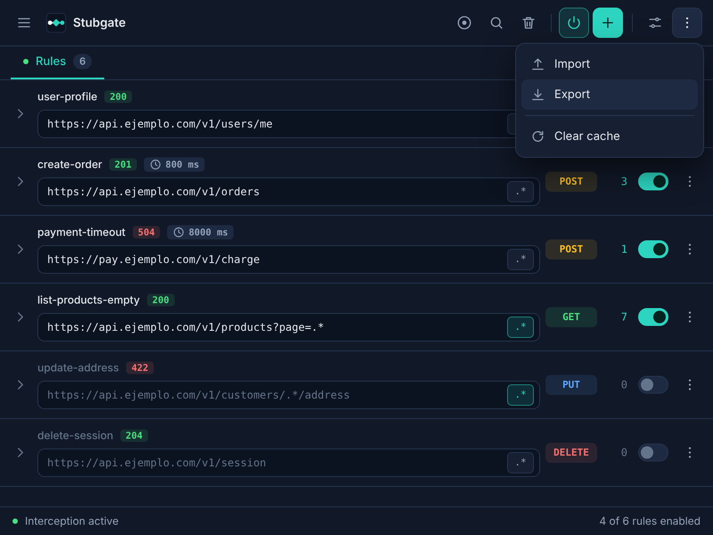
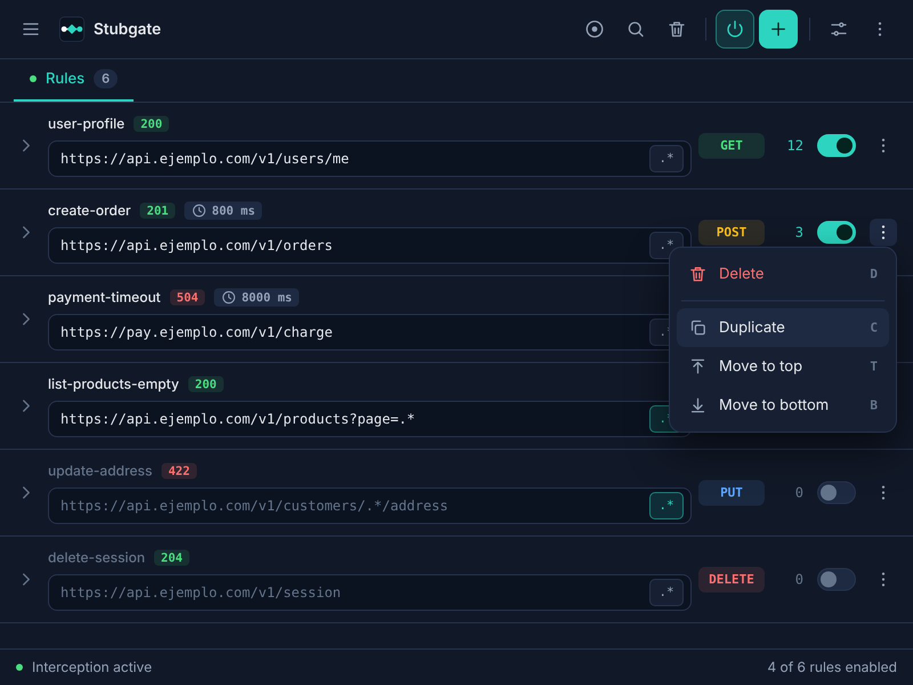
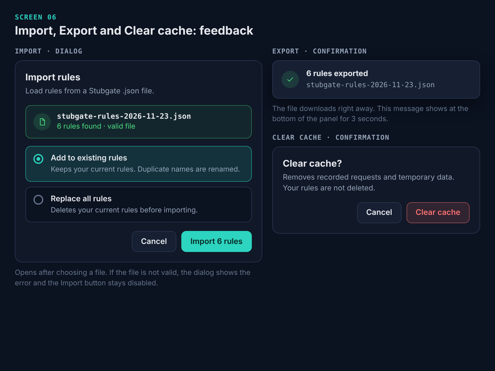
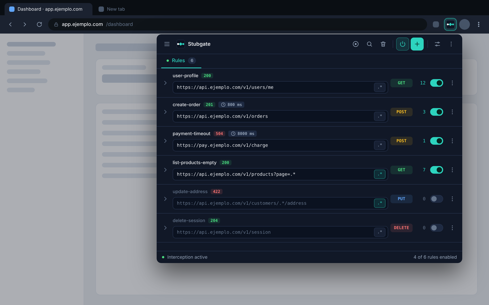
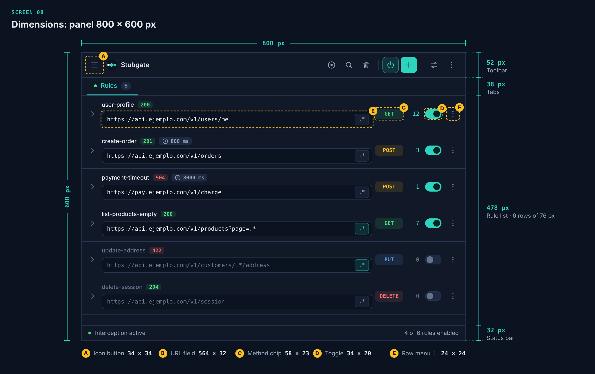

# Diseño de interfaz de Stubgate

> Pantallas, medidas y estado del diseño. Imágenes en [`assets/ui`](../assets/ui).

## Cómo se abre

Al instalar Stubgate aparece su ícono en la barra del navegador. Al hacer clic en él se **despliega un panel** (popup) con la lista de reglas y la barra de herramientas.

- **Tamaño de diseño: 800 × 600 px.** Es el máximo que permiten Chrome y Firefox para el popup de una extensión, así que todas las pantallas se diseñan dentro de ese límite (ver «Dimensiones», más abajo en este documento).
- Las imágenes están exportadas al doble (1600 × 1200 px) para que se vean nítidas.
- Idioma de la interfaz: **español e inglés** (se elige en Settings, ver [04-idioma.md](04-idioma.md)). Las imágenes de este documento se muestran en inglés, que es el idioma base. El documento explica en español.

## Pantalla 01: Panel de reglas

Es lo primero que ve la persona al abrir la extensión.

| Zona | Contenido |
|---|---|
| Barra de herramientas | Las 8 funciones (ver pantalla 02) |
| Pestaña **Rules** | Punto de estado y contador con el total de reglas |
| Lista de reglas | Una fila por regla, ver detalle abajo |
| Barra de estado | Si la intercepción está activa y cuántas reglas están habilitadas |

**Qué tiene cada fila de regla**

| Elemento | Descripción |
|---|---|
| Flecha `>` | Expande la regla para editarla (pantalla 03) |
| Nombre | La etiqueta (label) de la regla |
| Chip de status | Código que devolverá: verde si es 2xx/3xx, rojo si es 4xx/5xx |
| Chip de delay | Solo aparece si el delay es mayor a 0 |
| URL | Campo de texto con el botón `.*` para activar expresión regular |
| Método | Etiqueta de color: GET verde, POST ámbar, PUT azul, DELETE rojo |
| Contador | Cuántas veces la regla ha interceptado una petición |
| Interruptor | Activa o desactiva la regla. Desactivada se ve atenuada |
| Menú `⋮` | Delete, Duplicate, Move to top y Move to bottom (pantalla 05) |

## Pantalla 02: Barra de herramientas (8 funciones)

| # | Función | Para qué sirve |
|---|---|---|
| 1 | **Menú** (☰) | Menú de navegación. Su contenido queda pendiente de diseñar |
| 2 | **Record** (grabar) | Captura las llamadas de red de la página activa. Cada llamada capturada se puede convertir en regla con un clic |
| 3 | **Search** (buscar) | Filtra las reglas por nombre, URL, método o label |
| 4 | **Delete** (eliminar) | Borra todas las reglas o solo las desactivadas. Siempre pide confirmación |
| 5 | **Global switch** (pausa global) | Pausa o reanuda la intercepción de todas las reglas sin perderlas |
| 6 | **New rule** (+) | Crea una regla nueva y abre el editor (pantalla 03) |
| 7 | **Settings** (ajustes) | **Idioma (Español / English)**, tema claro/oscuro y valores por defecto de las reglas nuevas |
| 8 | **More** (⋮) | Abre el menú con **Import**, **Export** y **Clear cache** (pantalla 04) |

> Interpreté así los 8 íconos que marcaste en rojo en tu captura. Si alguno debe hacer otra cosa, se ajusta aquí y en la imagen.

**Estados del interruptor global (5)**

| Estado | Aspecto | Comportamiento |
|---|---|---|
| Activo | Verde azulado | Las reglas se aplican a las peticiones que coincidan |
| Pausado | Rojo, y el panel muestra un aviso ámbar: *Interception paused. Your rules are kept but not applied.* | Las peticiones van al servidor real |

## Pantalla 03: Nueva regla

Se abre al pulsar **+** (función 6). La regla nueva aparece expandida arriba de la lista, marcada como `draft` hasta que tiene una URL.

Versión con números para seguir la tabla de opciones:

### Opciones al crear una regla

| # | Opción | Qué hace | Valor por defecto | ¿Obligatoria? |
|---|---|---|---|---|
| 1 | **URL to match** | URL a interceptar. El botón `.*` activa la coincidencia por expresión regular. También se puede **pegar un comando cURL** y se rellenan URL, método y headers | vacía | Sí |
| 2 | **HTTP method** | GET, POST, PUT, PATCH, DELETE, HEAD, OPTIONS o ANY | GET | Sí |
| 3 | **Status code** | Código de respuesta (200 a 599; `new Response()` rechaza códigos fuera de ese rango). Muestra al lado el texto estándar (200 → OK). Atajos para los más usados: 200, 201, 204, 400, 401, 403, 404, 429, 500, 503 | 200 | Sí |
| 4 | **Delay by (ms)** | Milisegundos que espera antes de responder, para simular latencia o timeouts | 0 | No |
| 5 | **Label** | Nombre de la regla para encontrarla fácil | vacío (se muestra la URL) | No |
| 6 | **Rule type** | Qué hace la regla. En la v1 solo existe **Mock**: reemplaza la respuesta completa | Mock | Sí |
| 7 | **Response body** | Editor del cuerpo de la respuesta, con colores para JSON y números de línea | `{ "message": "OK", "data": [] }` | No |
| 8 | **Response headers** | Lista de pares clave/valor. El contador de la pestaña muestra cuántos hay | `Content-Type: application/json` | No |
| 9 | **Notes** | Texto libre para documentar para qué sirve la regla | vacío | No |
| 10 | **Interruptor de la regla** | Activa o desactiva solo esta regla | Activada | No |
| 11 | **Menú ⋮ de la regla** | Delete, Duplicate, Move to top y Move to bottom (pantalla 05) | | No |
| 12 | **Herramientas del editor** | Formatear JSON, plegar/desplegar y copiar al portapapeles | | No |

**Comportamientos**

- **Guardado automático**: no hay botón "Guardar". El pie del editor muestra *Saved automatically*.
- **Validación**: si el body es JSON, el pie muestra *Valid JSON* en verde. Si hay un error, se muestra en rojo con la línea, pero la regla se puede guardar igual (a veces se quiere simular una respuesta rota a propósito).
- **Contador de la pestaña**: al crear la regla, el número de *Rules* sube.
- **Pegar cURL**: al pegar un comando cURL en el campo de URL, se rellenan los demás campos.

### Visto en Tweak, fuera de la v1

En la pantalla de referencia hay otras opciones que quedan para después: **Request payload** (modificar lo que se envía), **Response hook** (editar la respuesta con JavaScript) y **Debugging** (breakpoints). En Tweak las tres son de pago.

## Pantalla 04: Menú "More" (⋮ de la barra)

Se abre con la función 8 de la barra de herramientas.

| Opción | Qué hace |
|---|---|
| **Import** | Abre el selector de archivos para elegir un `.json` exportado desde Stubgate. Antes de importar muestra el diálogo de la pantalla 06 |
| **Export** | Descarga **todas** las reglas en un solo archivo llamado `stubgate-rules-AAAA-MM-DD.json`. No pide confirmación: avisa cuando termina |
| **Clear cache** | Borra los datos temporales (peticiones grabadas con Record y caché interno). **No borra las reglas**. Pide confirmación |

*Import* y *Export* son la base para compartir reglas entre personas mientras no exista trabajo en equipo. Ver el formato del archivo en las notas técnicas.

## Pantalla 05: Menú de la regla (⋮ de cada fila)

Se abre con el botón `⋮` de cualquier fila de la lista.

| Opción | Atajo | Qué hace |
|---|---|---|
| **Delete** | `D` | Elimina la regla. Se muestra en rojo y separada de las demás |
| **Duplicate** | `C` | Crea una copia justo debajo, con el mismo contenido y el nombre terminado en *copy*. La copia queda desactivada para que no haya dos reglas iguales aplicándose a la vez |
| **Move to top** | `T` | Sube la regla al primer lugar de la lista. Aparece atenuada si ya es la primera |
| **Move to bottom** | `B` | Baja la regla al último lugar. Aparece atenuada si ya es la última |

- **Atajos de teclado:** con el menú abierto, pulsar la letra ejecuta la acción sin usar el mouse.
- **Por qué importa el orden:** si dos reglas coinciden con la misma petición, se aplica **la que está más arriba**. Por eso existen *Move to top* y *Move to bottom*.

## Pantalla 06: Avisos de Import, Export y Clear cache

| Acción | Qué ve la persona |
|---|---|
| **Import** | Un diálogo con el nombre del archivo y cuántas reglas trae. Dos modos: **Add to existing rules** (agrega a las que ya hay; si un nombre se repite, se renombra) y **Replace all rules** (borra las actuales antes de importar). Si el archivo no es válido, muestra el error y el botón *Import* queda desactivado |
| **Export** | La descarga empieza de inmediato y aparece un aviso breve (3 segundos) con el número de reglas y el nombre del archivo |
| **Clear cache** | Un diálogo de confirmación que aclara que las reglas no se borran. El botón es rojo porque la acción no se puede deshacer |

## Pantalla 07: El panel desplegado en el navegador

Así se ve al hacer clic en el ícono de la extensión: el panel aparece **debajo del ícono, sobre la página**, sin mover ni redimensionar el contenido de la web. Se cierra al hacer clic fuera de él.

- **Tamaño de la maqueta: 1280 × 800 px**, el mismo que pide la Chrome Web Store para las capturas de pantalla. Se exportó también a `assets/store/screenshot-1-1280x800.png` para usarla como primera captura de la tienda.
- La ventana del navegador es **genérica**: no imita a ningún navegador concreto, porque Stubgate debe verse igual en todos.
- **La posición la decide el navegador**, no la extensión. Stubgate controla el contenido y su tamaño, pero no puede forzar dónde aparece.
- Mientras el panel está abierto, el ícono de la extensión se resalta.

---

# Dimensiones

## Pantalla 08: Plano de medidas

Todas las medidas están en píxeles CSS y se tomaron del diseño renderizado, no a ojo. Las letras A a E de la imagen corresponden a la tabla de la fila de regla.

## Límites por navegador

| Navegador | Tamaño máximo del popup | Estado |
|---|---|---|
| Chrome | 800 × 600 | Confirmado (foro oficial de extensiones de Chromium) |
| Firefox | 800 × 600 (antes de Firefox 60, el ancho máximo era 680) | Confirmado (MDN). Si el botón está en el menú de desbordamiento, el panel tiene un ancho fijo que la documentación no indica |
| Edge, Brave, Opera | Igual que Chrome | **Sin verificar**: comparten la base Chromium, pero hay que probarlo |
| Safari | Sin dato | **Sin verificar**: probar en un Mac |

- **Mínimo:** ninguna fuente consultada lo indica. Los popups se ajustan al contenido, por eso el diseño fija el tamaño del `html` y del `body` en 800 × 600 para que no cambie según el contenido.
- Según MDN, el popup llega a 800 × 600 "si cabe en la pantalla del usuario". En pantallas o ventanas pequeñas el navegador lo reduce, así que hay que probar con tamaños menores.
- Esto es un **máximo**: para trabajar con más espacio existen las opciones pendientes *Open in new tab* y *Open in floating window*.

## Zonas del panel (800 × 600)

| Zona | Alto | Ancho |
|---|---|---|
| Barra de herramientas | 52 | 800 |
| Pestañas (*Rules*) | 38 | 800 |
| Lista de reglas | 478 | 800 |
| Barra de estado | 32 | 800 |
| **Total** | **600** | **800** |

## Barra de herramientas

| Elemento | Medida |
|---|---|
| Botón de ícono | 34 × 34 |
| Botón primario (+ New rule) | 34 × 34 |
| Separador vertical | 1 × 20 |
| Logo junto al nombre | 22 × 22 |
| Margen izquierdo | 10 |

## Fila de regla (76 de alto)

| Elemento | Medida | Nota |
|---|---|---|
| Flecha (expandir) | 26 × 18 | Empieza en x = 10 |
| Campo URL (**B**) | 564 × 32 | Empieza en x = 42. Contiene el botón `.*` |
| Botón `.*` | 30 × 24 | Dentro del campo URL |
| Chip de método (**C**) | 58 × 23 | |
| Contador de usos | 22 de ancho | |
| Interruptor (**D**) | 34 × 20 | |
| Menú ⋮ (**E**) | 24 × 24 | |
| Grupo derecho | 174 de ancho | Método, contador, interruptor y menú. Margen derecho de 14 |
| Botón de ícono de la barra (**A**) | 34 × 34 | |

**Capacidad:** caben 6 filas completas (6 × 76 = 456) más 22 px libres. Con más reglas aparece scroll vertical dentro de la lista.

## Editor de regla (pantalla 03)

| Elemento | Medida |
|---|---|
| Margen del cuerpo | 14 |
| Fila de campos | 55 de alto (etiqueta + campo de 34) |
| Columnas de campos | 112 · 128 · 124 · flexible (≈ 206) · 130, con separación de 10 |
| Sangría izquierda de los campos | 46 |
| Pestañas del editor | 37 de alto |
| Área de código | Flexible, ocupa el resto (≈ 740 × 299) |
| Pie del editor | 32 de alto |

## Menús

| Menú | Medida | Posición |
|---|---|---|
| More (⋮ de la barra) | 212 × 129 | 48 desde arriba y 10 desde el borde derecho |
| Menú de la regla | 200 × 163 | Se abre bajo el ⋮ de la fila, a 14 del borde derecho |

Cada opción mide 34 de alto, el relleno del menú es de 6 y los separadores son de 1 con 6 de margen.

## Decisiones tomadas al medir

- **Áreas clicables de al menos 24 × 24.** El menú ⋮ medía 20 × 18 y el botón `.*` 27 × 17, demasiado pequeños para hacer clic con comodidad. Ahora miden 24 × 24 y 30 × 24, sin cambiar su dibujo.
- **Fila de 76 exactos** (antes 75,8 por redondeos del texto), para que las cifras sean limpias.
- **Español:** en la prueba de la pantalla 03, "Código de estado" no cabía en su columna de 92 y se partía en dos líneas, desalineando el campo. Las columnas se ensancharon (92 pasó a 128) y la etiqueta no se parte. **Solo se probó la pantalla 03 en español**; falta el resto.

## Recursos para las tiendas

Datos de la Chrome Web Store (developer.chrome.com/docs/webstore/images). Las otras tiendas tienen sus propios requisitos y hay que verificarlos.

| Recurso | Tamaño | ¿Obligatorio? | Estado |
|---|---|---|---|
| Ícono de la tienda | 128 × 128, con el dibujo en 96 × 96 y 16 de margen transparente por lado | Sí | Hecho: `assets/store/store-icon-128.png` |
| Capturas de pantalla | 1280 × 800 o 640 × 400, mínimo 1 y hasta 5, sin bordes ni márgenes | Sí | 1 de 5: `assets/store/screenshot-1-1280x800.png` |
| Imagen promocional pequeña | 440 × 280 | No | Pendiente |
| Imagen marquee | 1400 × 560 | No | Pendiente |
| Íconos dentro de la extensión | 16, 32, 48 y 128 | Sí | Hechos |

El ícono de la tienda es distinto del ícono de 128 px de la extensión: lleva margen transparente.

---

# Pendientes y estado del diseño

## Pendiente de documentar y diseñar

Funciones que se vieron en la referencia y se dejan para más adelante:

| Función | Dónde está | Nota |
|---|---|---|
| **Enabled sites** | Menú More | Elegir en qué sitios actúa la extensión |
| **Settings** (dentro del menú) | Menú More | Ya existe como botón de la barra (función 7) |
| **Open in floating window** | Menú More | Abrir el panel como ventana flotante |
| **Open in new tab** | Menú More | Abrir el panel en una pestaña completa |
| **Move to collection** | Menú de la regla | Requiere colecciones. En la referencia es de pago |
| Estado vacío (sin reglas) | Panel | Pantalla de bienvenida |
| Record (grabación) | Barra | Pantalla de peticiones capturadas |
| Settings | Barra | Pantalla de ajustes. Debe incluir el **selector de idioma (Español / English)** |
| Menú ☰ | Barra | Navegación |
| Estados del ícono en la barra del navegador | Navegador | Activo (en color) y pausado (en gris). Se ve así en tu captura de referencia; aún no está diseñado |
| Estados de hover, foco por teclado y deshabilitado | Todas | Definirlos para botones, campos, filas y menús |
| Versión en español de todas las pantallas | Todas | Solo la 03 se ha probado |

## Estado de las pantallas

| # | Pantalla | Estado |
|---|---|---|
| 01 | Panel de reglas | Hecha |
| 02 | Barra de herramientas | Hecha |
| 03 | Nueva regla | Hecha |
| 04 | Menú More (Import, Export, Clear cache) | Hecha |
| 05 | Menú de la regla (Delete, Duplicate, Move to top/bottom) | Hecha |
| 06 | Avisos de Import, Export y Clear cache | Hecha |
| 07 | Panel desplegado en el navegador | Hecha |
| 08 | Plano de dimensiones | Hecha |
| 09 en adelante | Ver la tabla de pendientes | Pendiente |

---
